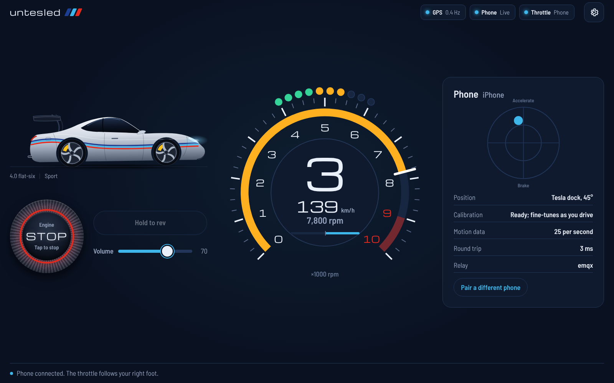
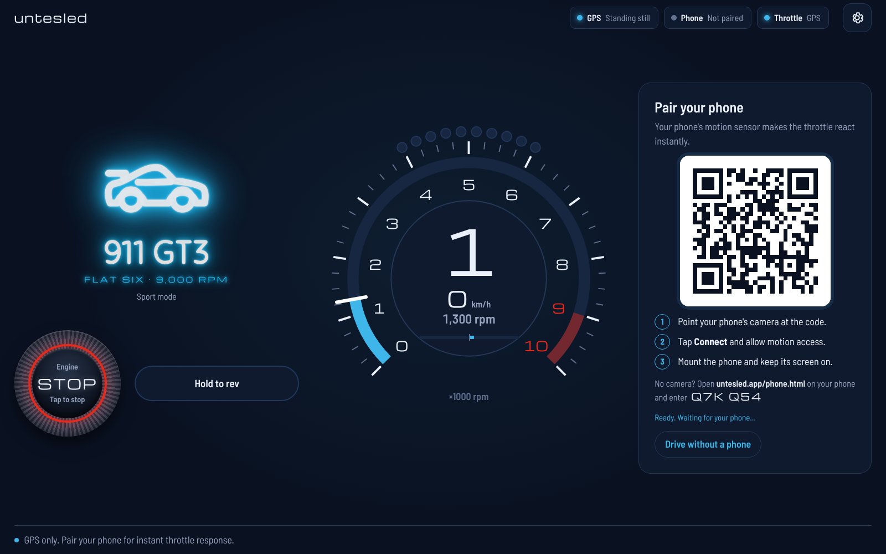
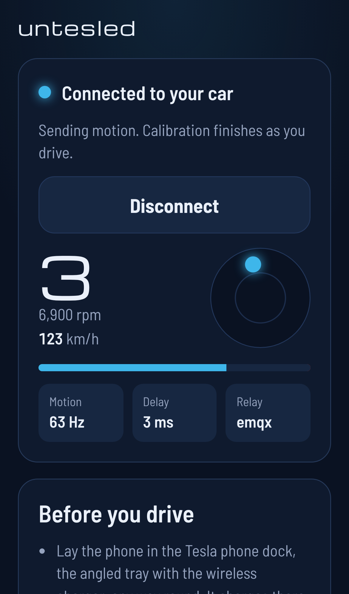
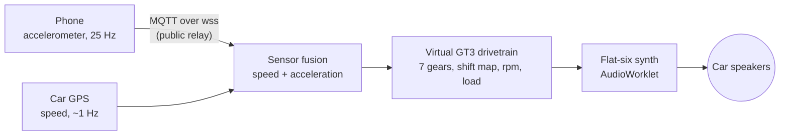

# Untesled

A flat-six engine for your Tesla. Untesled is a static web app that runs in
the Tesla's browser and plays a synthesized 4.0-litre, 9,000 rpm,
GT3-style boxer through the car's speakers. It reacts to how you actually
drive: the car's GPS gives the speed, and your phone's accelerometer gives
an instant throttle.



| Pairing (first screen) | Phone, connected |
| --- | --- |
|  |  |

- **No audio files.** Every sound is synthesized live in the browser: firing
  pulses, exhaust pipes, intake howl, shift cuts, blips, pops and bangs.
- **Scan and go.** The car shows a QR code. Scan it with your phone camera,
  tap Connect, done. It works on any network, with no app and no account.
- **Works without the phone, too.** On GPS alone the engine follows your
  speed about a second late. The phone makes it instant.
- **Plain HTML, CSS and JavaScript.** No framework, no build step, no runtime
  dependencies. Deploy the folder as it is.

## How it works



1. The phone streams its motion through a free public MQTT relay to the car.
   Nothing to host: the site is static, and both sides connect to several
   relays at once and use whichever answers first.
2. The car fuses that with its own GPS. GPS is the truth for speed, and the
   phone is the truth for acceleration (it reacts within about 0.1–0.2 s).
3. A virtual 7-speed dual-clutch gearbox turns speed and acceleration into
   gear, rpm and throttle, then feeds the engine synth.

## Use it in the car

1. Open your site (for example `https://yourdomain.com`) in the Tesla browser.
2. Allow **location** when the browser asks. That is how the engine knows
   your speed.
3. Tap **Start**. You'll hear the starter, the catch and a cold-start flare.
4. Pair your phone (optional, recommended):
   1. Point the phone's camera at the QR code on the car's screen and open
      the link.
   2. Tap **Connect**. On iPhone, tap **Allow** when it asks for motion
      access. Android starts by itself.
   3. Lay the phone in the **Tesla phone dock** (the angled wireless-charging
      tray, about 45°), any way round, and keep the page open with the screen
      on. It charges while it streams. A dash or vent holder works too.
5. Drive. The phone calibrates itself in the first few seconds of driving
   (see *How the phone is understood*).

No camera? Open `yourdomain.com/phone.html` on the phone and type the
six-character code shown under the QR code. The phone remembers the code, so
next time just open the page again. The car keeps its code between visits
too; use **Settings › New code** if you want a fresh one.

While stopped, hold **Hold to rev** to blip the engine in neutral and bounce
it off the limiter.

### Permissions

| Device | What it asks | If you said no |
| --- | --- | --- |
| Tesla browser | Location | Allow location for the site in the browser's site settings, then reload. |
| iPhone (Safari) | Motion & orientation, after tapping Connect | Close the tab, scan the QR again and tap Allow. |
| Android (Chrome) | Nothing, usually | Chrome › site settings › Motion sensors › Allow. |

Both sensors only work on **https://** pages, which is why the site must be
published with SSL.

### Settings

- **Drive mode**:
  - *Comfort*: early upshifts and a quieter exhaust.
  - *Sport*: holds gears, blips on downshifts, crackles when you lift.
  - *Track*: revs to the limit, aggressive downshifts.
- **Pops and bangs**: Off, Mild or Wild.
- **Speed**: km/h or mph.
- **Simulator**: on-screen throttle and brake pedals, also on the keyboard
  (↑ / ↓, hold Shift for half). The simulated car behaves like a Tesla, with
  instant torque and one-pedal regen. Try everything without a car or a phone.
- **Pairing code**: shows the code and lets you make a new one.

## Publish it

The site is the repository root: `index.html` (car), `phone.html` (phone),
`style.css`, `js/`, `assets/`. Any static host with HTTPS works.

### Hostinger, deployed from GitHub

1. In **hPanel › Websites › Manage › Advanced › GIT**, create a repository:
   - Repository: `https://github.com/arnaumas27/untesled.git`. For a private
     repository, add the SSH key Hostinger shows to GitHub as a deploy key
     and use `git@github.com:arnaumas27/untesled.git`.
   - Branch: the one you want to publish, for example `main`.
   - Directory: leave empty to deploy into `public_html`, which must be empty.
2. Click **Create**, then **Deploy**.
3. Optional, auto-deploy on every push: in the same GIT section open
   **Auto deployment**, copy the webhook URL, and add it in GitHub under
   **Settings › Webhooks › Add webhook**.
4. Turn on SSL in **hPanel › Security › SSL** (the free certificate is
   enough). The included `.htaccess` sends every visitor to `https://`; it
   also sets the right file types and makes updates show up immediately.
5. Open `https://yourdomain.com` in the Tesla browser.

### GitHub Pages (alternative)

**Settings › Pages › Deploy from a branch**, then pick the branch and
`/ (root)`. The site appears at `https://arnaumas27.github.io/untesled/`
with HTTPS already on. (The `.htaccess` file is simply ignored there.)

### On your computer

```bash
python3 -m http.server 8080
```

Then open <http://localhost:8080>. The engine, the simulator and every
setting work locally. Pairing a phone needs the published `https://` site,
because your phone can't reach your computer's `localhost`.

After the first visit, a small service worker (`sw.js`) lets the app open
even without a connection. It always tries the network first, so new deploys
appear straight away. The phone link itself still needs internet on both
devices.

## Configuration

Everything lives in `js/config.js`:

- **`brokers`**: the public MQTT-over-WebSocket relays (EMQX, HiveMQ,
  Mosquitto, Eclipse). Both pages connect to all of them in parallel, and
  pairing works as long as one is reachable from both the car and the phone.
  For full control, run your own broker (for example Mosquitto with
  WebSockets, or a free HiveMQ Cloud or EMQX Serverless instance) and put it
  first. Each entry can carry a `username` and `password`.
- **`phoneSendHz`**: motion messages per second (25 by default).
- To try a different broker without editing files, add
  `?broker=wss://host:port/path` to the car page URL; the QR code passes it on
  to the phone.

## The sound engine

`js/engine-worklet.js` runs in an AudioWorklet on its own audio thread. A
ScriptProcessor fallback runs the same code on browsers without worklets
(force it with `?noworklet`). Per sample:

- **Crankshaft and firing order.** One 720° cycle, six firings in the boxer
  order 1-6-2-4-3-5, alternating left bank (1–3) and right bank (4–6). The
  fundamental is rpm ÷ 20 Hz (450 Hz at 9,000 rpm).
- **Exhaust pulses.** Each firing is a pressure pulse: a sharp blowdown peak,
  then a scavenging dip. Its strength follows the load, and its sharp
  "crack" grows with throttle. The blowdown lasts about 10 ms whatever the
  revs, so idle sounds like separate, lumpy beats and high rpm merges them
  into a wail. Every cylinder is a little different and every event jitters
  slightly, so no two cycles are identical.
- **Deep, GT3-style voicing.** The right bank's pulses reach the tailpipes a
  little later and weaker than the left bank's, as with unequal exhaust
  paths. That makes the boxer's 1.5 engine order carry the sound: a note an
  octave below the firing frequency, about 100 Hz at 4,000 rpm and 210 Hz at
  8,500 rpm. It survives mono playback, so the car's subwoofer reproduces it.
- **Pipes.** Each bank feeds its own long header, modelled as a resonant
  delay line with low resonances. Short tailpipe combs add the metallic
  edge.
- **Body resonances.** A fixed bank of resonances (body boom around 80 Hz,
  muffler, rasp) doesn't move with rpm. Different harmonics light up as the revs climb,
  as in a real car.
- **Intake howl.** Intake strokes ring through plenum and runner
  resonances, with air rush that grows with throttle (individual throttle
  bodies, GT3-style).
- **Extras.**
  - Valve-train ticks, a faint gear whine, sub-bass at the firing order and
    the 1.5 order.
  - The starter motor, plus a settling thump at shutdown.
  - Overrun burble with afterfire **pops and bangs**: random, louder right
    after you lift and at high revs, plus a "brap" on upshift cuts.
  - The rev limiter stutter.
- **Output.** Tone opens with load and revs, saturation adds grit at full
  throttle, and a bass shelf adds weight. A loudness curve keeps idle
  quieter than full throttle, and a limiter protects the speakers.

Every character setting lives in one `VOICE` table at the top of
`js/engine-worklet.js`: bank lag and strength, pulse length, pipe lengths,
body resonances, intake, sub-bass and tone. Change it there to make the
engine deeper or brighter.

The synth uses about 2 % of one desktop CPU core.

## The virtual drivetrain

`js/vehicle.js` models a 992 GT3-style PDK:

- Ratios 3.75 / 2.38 / 1.72 / 1.34 / 1.11 / 0.96 / 0.84, final drive 4.47,
  315/30 R21 rear tyres. 100 km/h in 7th is about 2,750 rpm; 1st runs to
  about 73 km/h.
- **Throttle** is estimated from the car's acceleration compared with what a
  Tesla can do at that speed, so flooring it sounds flat-out in any model.
  Lifting off (regen) means a closed throttle: overrun and crackle.
- A **shift map** for each mode, with hysteresis, kickdown, and gear holding
  for engine braking. Upshifts cut the ignition; downshifts blip the
  throttle. Clutch slip at launch, a 9,000 rpm limiter, cranking and a
  cold-start fast idle.

## How the phone is understood

`js/fusion.js`:

- Gravity tells which plane is horizontal. **Which way is forward** is
  learned automatically by matching the phone's horizontal acceleration
  against the speed changes the GPS reports, using a small least-squares fit.
  It converges during the first few seconds of driving, in any orientation.
- **The Tesla phone dock needs no calibration to start.** The console tray
  rises towards the dashboard, so a phone lying in it (about 45°) always has
  its screen facing up and back, whether its top points forward or back, and
  even in landscape. Forward is then "behind the screen", flattened to
  horizontal, so the throttle is right from the first second. The car screen
  shows the detected position and angle, for example *Tesla dock, 45°*. The
  same logic covers upright dash and vent holders.
- A phone lying flat gives no such hint, so it isn't trusted until it has
  calibrated, and it can never throttle backwards.
- Picking the phone up is detected (it spins), and it recalibrates once it is
  put down again. iOS reports acceleration with the opposite sign to Android;
  the phone page checks the sign against its orientation and corrects it.
- Between GPS fixes, speed is integrated from the phone. GPS corrects it
  with lag compensation, and also corrects any slow bias in the phone.
- If the phone drops out, everything falls back to GPS within half a second.
  If GPS goes quiet while standing still, which browsers often do, that
  counts as standing still, not as lost.

## Project files

| File | What it does |
| --- | --- |
| `index.html` | Car screen: tachometer, start button, car illustration, pairing and simulator. |
| `phone.html` | Phone screen: pairing and motion streaming. |
| `style.css` | Styles for both pages. |
| `js/app.js` | Car page: wires sensors, fusion, vehicle, audio, link and UI together. |
| `js/ui.js` | Car screen rendering (tach, readouts, animated car, panels, settings). |
| `js/vehicle.js` | Virtual GT3 drivetrain. |
| `js/fusion.js` | GPS + phone sensor fusion and automatic calibration. |
| `js/engine-worklet.js` | The flat-six synthesizer (AudioWorklet). |
| `js/audio.js` | Web Audio graph, volume, limiter, ScriptProcessor fallback. |
| `js/gps.js` | Geolocation tracking and speed. |
| `js/simulator.js` | Virtual pedals and a simple EV model. |
| `js/link.js` | Pairing protocol over MQTT: codes, discovery, failover, heartbeats. |
| `js/mqtt.js` | Minimal MQTT 3.1.1 client over WebSocket. |
| `js/qr.js` | QR code generator (SVG). |
| `js/phone.js` | Phone page logic. |
| `js/config.js` | Relays and rates. |
| `sw.js` | Offline support (network first). |
| `.htaccess` | HTTPS redirect, file types and caching for Hostinger. |
| `tests/` | Unit tests (`npm test`, Node 20+, no dependencies). |

## Development

```bash
npm test
```

This runs the tests for the drivetrain, sensor fusion and synth. Add
`?noworklet` to force the audio fallback, or `?broker=…` to use another
relay. In the browser console, `untesled` exposes the live objects, for
example `untesled.vehicle.rpm`.

What has been verified so far:

- In headless Chromium:
  - pairing through the real QR code over https/wss;
  - phones emulated as Android, and as iPhone with its permission prompt and
    sign convention;
  - relay failover and phone takeover;
  - the simulator and both audio paths;
  - offline start.
- Offline renders of the synth, checked for levels, spectrum and CPU.

It has not been tried in a real Tesla yet. If something behaves differently
there, the console object above is the place to look.

## Troubleshooting

- **No sound.**
  - Tap **Start**. Browsers only allow sound after a tap.
  - Check the volume slider and the car's media volume.
  - If the browser paused audio after you switched apps, tap the engine
    button once to resume.
- **"Location is blocked".** Allow location for the site in the Tesla
  browser, then reload.
- **The phone can't find the car.**
  - Check that both are online and the code on the phone matches the car.
  - Under the QR code, "Ready. Waiting for your phone…" means the car
    reached a relay.
  - If it says it can't reach the relay, the car has no internet, or all
    relays are blocked on that network.
- **The phone keeps dropping.**
  - The phone must stay on this page with the screen on. Low Power Mode and
    auto-lock stop it; the page asks for a wake lock where supported.
  - The car carries on with GPS meanwhile and picks the phone back up
    automatically.
- **The engine reacts late.** You're on GPS alone. Pair the phone.
- **"Another phone is connected".** The last phone to connect wins. Tap
  **Use this phone** to take over.

## Privacy and safety

- Nothing is recorded or uploaded except the live motion stream. It carries
  only acceleration plus the engine's rpm, gear and speed, never location.
  It passes through public relays, under a topic named after your pairing
  code; for privacy, use your own broker (see *Configuration*).
- Set the phone up before driving, and never handle it while driving.
- Keep the volume at a level where you can still hear what's around you,
  including emergency vehicles. Synthetic engine sound may be restricted in
  some places; check your local rules.

## Credits

- Fonts: [Michroma](https://fonts.google.com/specimen/Michroma) and
  [Barlow Semi Condensed](https://fonts.google.com/specimen/Barlow+Semi+Condensed),
  both under the SIL Open Font License 1.1. They are served from
  `assets/fonts/`, with their licenses alongside.
- Untesled is a fan project. It is not affiliated with or endorsed by
  Porsche or Tesla. The engine is an original synthesis inspired by
  naturally aspirated flat-sixes, not a recording.
